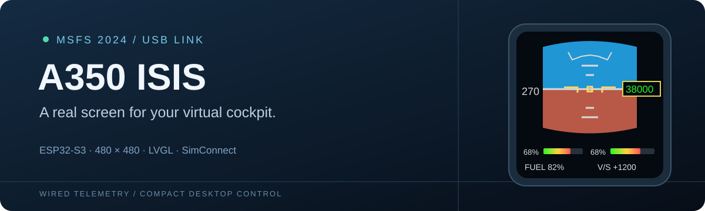
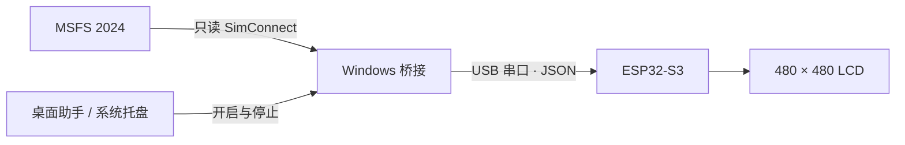
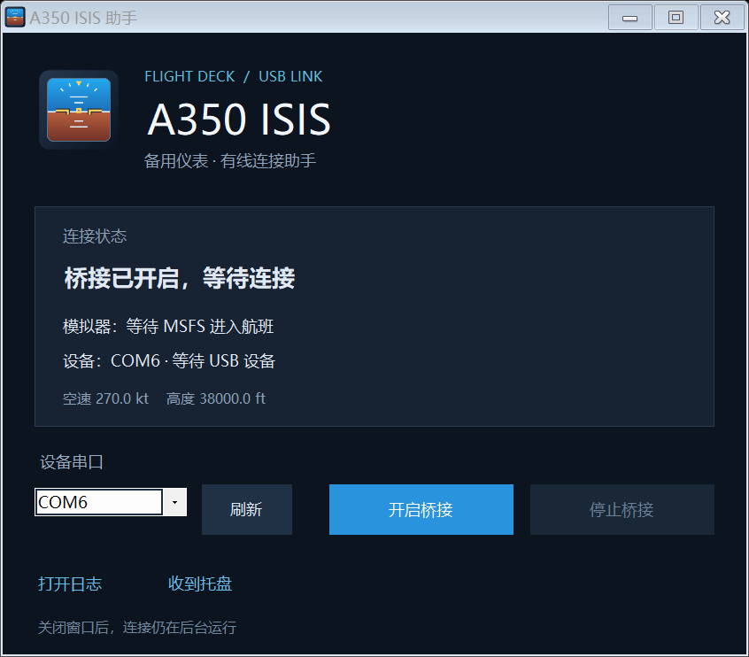

<p align="center"></p>

<p align="center">
  
  
  
  
</p>

# A350 ISIS · 实体飞行仪表

把 MSFS 2024 的飞行数据，带到桌面上的一块真实屏幕。

本项目使用 **Waveshare ESP32-S3 4 英寸 LCD**，通过 **USB 有线连接**显示实时姿态、空速、高度、航向和辅助 HUD；配套 Windows 桌面助手负责连接、停止和托盘后台控制。界面以 A350 ISIS 备用仪表为设计参考，并加入适合日常模拟飞行的油门、反推、油量和垂直速度显示。

> 当前适配的是已验证的 **无触摸设备、480 × 480 方形屏幕、180° 安装方向**。封面为设计示意图，不是实物照片。本仓库提供源码，暂未提供 GitHub Release 安装包。

## 功能一览

| 模块 | 当前能力 |
| --- | --- |
| 姿态与飞行数据 | 动态地平线、俯仰与横滚、空速、高度、航向、马赫数、气压设定 |
| 油门 | 自动按发动机数量横排 1–4 组；左侧百分比、右侧粗进度条 |
| 颜色反馈 | 杆位升高时，进度条由绿经过黄逐渐变红 |
| 反推 | 对应油门位置显示黄色 `REV` 提示 |
| 辅助 HUD | 油量百分比、垂直速率；统一字号与白色文字 |
| 连接保护 | 数据校验、序列检查、失联超时、USB 和模拟器自动重连 |
| 桌面控制 | 串口选择、开启／停止、连接状态、日志入口、系统托盘 |
| 刷新方式 | 默认 20 Hz USB 数据发送，LVGL 按变化区域刷新 |

经纬度、SIM 来源框、LIVE 标签和额外气压单位文字已从屏幕移除，保留简洁的仪表布局。气压数值仍显示。

## 连接方式



**不使用 Wi-Fi，不向游戏写入控制指令。** SimConnect.dll 从电脑已有安装或用户提供的位置加载，本仓库不分发该 DLL。

## 开始使用

### 已有完整便携运行包

1. 用 USB 数据线连接已烧录本项目固件的屏幕。
2. 打开 `A350 ISIS 助手.exe`，选择实际串口，例如 `COM6`。
3. 启动 MSFS 2024 并进入航班，点击 **开启桥接**。
4. 关闭窗口后助手会收到托盘；右键托盘可开启、停止或退出。

请保留运行包里的 `tools` 和 `windows-bridge` 文件夹。**源码压缩包不等于便携运行包**：本仓库不包含 Python、ESP-IDF 工具链或本机生成的 EXE。

### 从源码运行桥接

需要 Windows x64、Python 3.11，以及可用的原生 x64 SimConnect.dll：

```powershell
python -m venv .venv
.\.venv\Scripts\python.exe -m pip install -r windows-bridge/requirements.txt

# 先只读取得一帧，不打开屏幕串口
.\.venv\Scripts\python.exe windows-bridge/bridge.py --dll "D:/YourPath/SimConnect.dll" --once

# 再持续向屏幕发送数据
.\.venv\Scripts\python.exe windows-bridge/bridge.py --dll "D:/YourPath/SimConnect.dll" --port COM6 --hz 20
```

使用 `Ctrl+C` 停止。也可以复制 `windows-bridge/config.example.json` 为 `config.local.json`，修改 DLL 路径和串口，再通过 `--config config.local.json` 启动。本机配置不会提交到仓库。

## 硬件与软件

| 项目 | 已验证配置 |
| --- | --- |
| 主控与屏幕 | ESP32-S3，4 英寸，480 × 480 LCD |
| 存储 | 16 MB Flash，8 MB PSRAM |
| 板级适配 | Waveshare V3 示例 / BSP 1.1.0，TCA9554 扩展器 |
| 交互 | 无触摸；180° 硬件翻转 |
| 固件 | ESP-IDF 5.3.4，LVGL 8.4 |
| 桌面桥接 | Python 3.11，pyserial 3.5，原生 SimConnect |
| Windows 助手 | C# / Windows Forms / .NET Framework |

其他硬件修订版的背光与初始化方式可能不同，请先核对板型。构建方式见 **[构建指南](docs/BUILD.md)**。

## 桌面助手

<p align="center"></p>

界面图用于展示控制窗口，不代表当前游戏读数。应用支持后台运行、单实例和已有桥接进程核验，避免重复占用同一串口。

## 项目结构

```text
esp32-firmware/       ESP32-S3 显示、USB 接收与数据模型
windows-bridge/       SimConnect → USB 桥接
  app/               Windows 桌面助手、图标与构建脚本
scripts/             界面生成、本地构建及打包辅助脚本
tests/               桥接、协议和布局测试
docs/                构建说明、协议与验证状态
assets/repo/         项目展示资源
```

- [构建指南](docs/BUILD.md)：固件、桌面助手与便携包的构建入口。
- [串口协议](docs/PROTOCOL.md)：字段、单位、有效性和断连行为。
- [验证状态](docs/PROJECT-STATUS.md)：已经确认的功能与仍待实测的部分。

## 测试

桥接与布局测试无需连接游戏或屏幕：

```powershell
python -m unittest discover -s tests -p "test_*.py" -v
```

当前 **19 项 Python 测试通过**；桌面助手的进程身份测试随 `windows-bridge/app/build.ps1` 执行。`tests/embedded/` 中的 Unity 用例需要独立 ESP-IDF 测试程序，不能把普通固件编译成功当作已运行这些用例。

## 当前边界

- 已完成实际屏幕烧录、USB 实时数据传输、断电重连和单发／双发数据接收验证。
- 四发识别及切换逻辑通过测试，**四发飞机的实物显示仍待实测**。
- 油门百分比表示模拟器的杆位，**不是 N1 或发动机推力**。`REV` 根据负杆位或反推装置展开状态显示。
- 燃油百分比为剩余总油量除以总容量；V/S 单位为 `ft/min`，显示按 50 ft/min 取整。
- 读取的是标准 SimVars，不声称复刻所有机型专有的 ISIS 内部逻辑。

## 许可与致谢

感谢 Waveshare、Espressif、LVGL、Python 和 pyserial 项目提供基础组件。第三方来源与许可见 [第三方组件说明](THIRD_PARTY_NOTICES.md)。

本项目自有代码的开源许可证尚未选定；仓库上传不表示已授予开源许可。项目与 Microsoft、Airbus、iniBuilds 或 Waveshare 无官方隶属关系。
